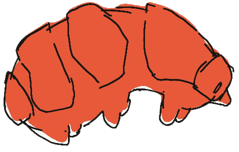

  

<h1 align="center">Tardigrade</h1>

Tardigrade is a distributed SQL database, developed in the open. It is
a CP system: serializable transactions, Raft replication per range,
PostgreSQL wire compatible. It survives minority-partition outages by
refusing work rather than diverging.

### Documentation

- [Changelog](./CHANGELOG.md)
- [Contributing](./CONTRIBUTING)
- [Commit message format](./COMMITS)
- [Contributor license agreement](./CLA)
- [Upstream technical docs](./docs/) — CockroachDB-authored design
  notes, RFCS, and tech notes, retained for reference

### Contributing

Discuss your change with the engineering team at [contact@podomy.com](mailto:contact@podomy.com) before opening a PR in order not to waste anybody's effort or time.

- [Commit message format](./COMMITS)
- [Contributor license agreement](./CLA)
- [Contributing](./CONTRIBUTING)

### License

Tardigrade is distributed under the GNU Affero General Public License v3.0 or
later. See [LICENSE](./LICENSE).
